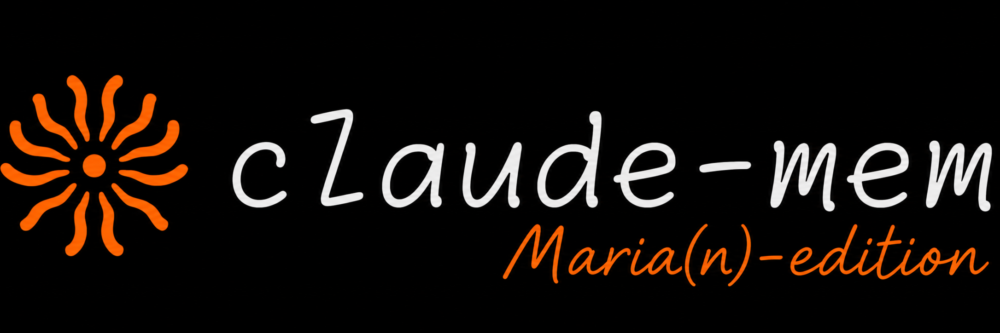

> [!NOTE]
> Read [MARIAN.md](MARIAN.md) for this fork's patch history. The first patch is **Maria-1**.

<p align="center">
  
</p>

# Marian

**Persistent agent memory with fewer OpenRouter requests and more reliable work tracking.**

Marian is a fork of [claude-mem](https://github.com/thedotmack/claude-mem), based on upstream **v15.5.0**. It retains the existing memory format while improving observation batching, session-based agent identity, rejected-rule Undo, and automatic refresh.

## What Marian changes

- **Batch observations:** up to eight pending tool observations share one OpenRouter generation request by default. Each input keeps its own result, ordering and provenance.
- **Keep memories independent:** queue items are acknowledged after persistence. Malformed output and retries preserve unresolved work without duplicating saved observations.
- **Record the right agent:** requests load agent identity from their associated sessions, including historical sessions, without increasing the observation limit or guessing from task names.
- **Restore rejected rules:** rejected suggestions remain available for the existing Undo action.
- **Complete refreshes:** Claude returns structured story output, Windows npm shims resolve to the official native executable, and failed final stages remain eligible for retry.

## Build from source

Use Node.js **20.19.x or later in the 20.x line, or 22.12+**, and Bun **1.1.31+**, as specified in [package.json](package.json).

```sh
git clone --branch marian https://github.com/8818x/claude-mem-marian.git Marian
cd Marian
npm install
npm run build
```

This fork publishes source patches. Run the build before packaging the generated plugin files. Follow the [installation guide](docs/public/installation.mdx) for agent integration and the [development guide](docs/public/development.mdx) for the project workflow.

## Configure batching

Set this value in your claude-mem settings file or environment:

```json
{
  "CLAUDE_MEM_OPENROUTER_OBSERVATION_BATCH_SIZE": "8"
}
```

| Setting | Default | Valid values |
| --- | --- | --- |
| `CLAUDE_MEM_OPENROUTER_OBSERVATION_BATCH_SIZE` | `8` | Integers `1–32` |

With batch size `8`, 14 ordinary pending observations use **two requests: 8 + 6**. Size `1` preserves one observation per request. Context budgets, compression, summaries and session boundaries can produce smaller batches.

See the [OpenRouter guide](docs/public/usage/openrouter-provider.mdx) and [configuration reference](docs/public/configuration.mdx) for provider credentials, models and other settings.

## Verification

Maria-1 passed **667 relevant tests across 47 files**, **92 My Work UI tests**, root/viewer typechecks, both repository lint checks and the full build. See [the patch record](MARIAN.md#maria-1--2026-10-29) for scope and verification limits.

## Compatibility

Marian preserves existing databases and settings files. Anthropic/Claude, Codex, Gemini and other providers keep their upstream observation behavior.

> [!IMPORTANT]
> Codex refresh execution remains blocked when the Windows sandbox cannot enforce its restricted read profile. Marian reports that limitation and keeps the restriction in place. Claude completed the live refresh verification.

For setup problems, consult [troubleshooting](docs/public/troubleshooting.mdx). Upstream authorship, Apache-2.0 terms and notices remain in [LICENSE](LICENSE) and [NOTICE](NOTICE).
